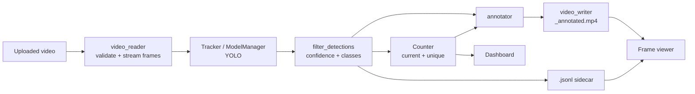

# VisionFlow Architecture

## Pipeline



Frames are streamed one at a time; nothing holds the whole video in RAM.

## Modules

| Module | Responsibility |
|---|---|
| `config/settings.py` | Typed settings from env / `.env` |
| `models/model_manager.py` | Loads YOLO, resolves device, `detect()` / `track()`, converts results to `Detection` |
| `detection/` | `Detection` dataclass, `filter_detections`, target/supported classes |
| `tracking/tracker.py` | `Tracker` interface and `UltralyticsTracker` (ByteTrack / BoT-SORT) |
| `tracking/track_state.py` | Per-class sets of observed track IDs |
| `counting/counter.py` | `count_current` and `update_unique` |
| `counting/statistics.py` | `ProcessingStats` and per-frame history |
| `video/video_reader.py` | Validation, metadata, streaming frame generator with frame skip |
| `video/video_writer.py` | mp4 writer context manager; optional H.264 re-encode via ffmpeg |
| `video/frame_processor.py` | `process_video` generator: read, detect, filter, count, annotate, write |
| `visualization/` | Annotator, dashboard widgets, frame viewer |
| `utils/` | Safe upload saving, output paths, logging |
| `app.py` | Streamlit UI wiring |

## Tracker interface

```python
class Tracker(ABC):
    def update(self, frame) -> list[Detection]: ...
    def reset(self) -> None: ...
```

`process_video` only needs a callable `frame -> list[Detection]` plus an optional `reset`, so another tracker is a new `Tracker` subclass; nothing else changes.

## Metric definitions

| Metric | Definition | Source |
|---|---|---|
| Current | Detections of a class in the current frame | `Counter.count_current` |
| Unique tracked | `len` of the per-class ID set accumulated over the run | `Counter.update_unique` / `TrackState` |
| Line crossing | Not implemented (post-MVP); will be a separate metric | |

Detections with `track_id=None` never add to unique counts. IDs are not stable across runs; state is reset at the start and end of each run.

## Error handling

Typed errors (`VideoValidationError`, `ModelError`, `TrackerError`, `VideoWriteError`) carry friendly messages shown via `st.error`; technical details go to the log only.
